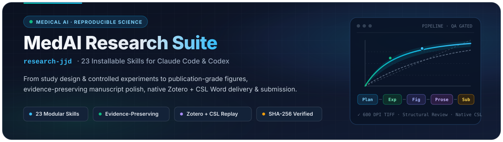
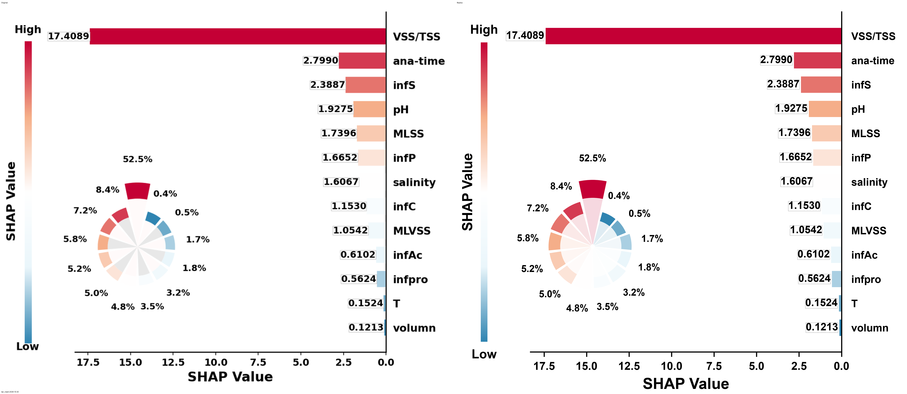
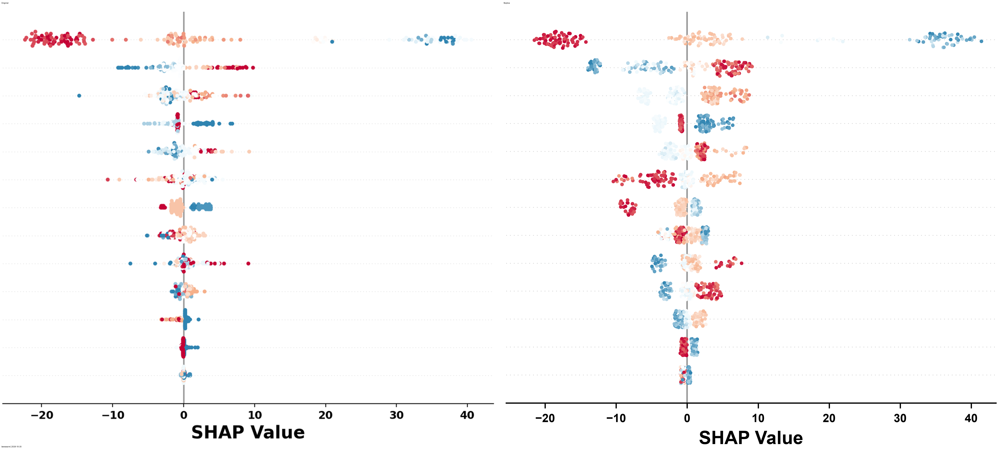
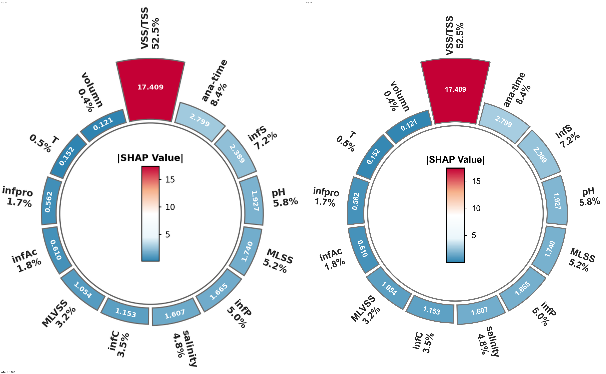

<div align="center">

<picture>
  <source media="(prefers-color-scheme: dark)" srcset="assets/hero-dark.svg">
  <source media="(prefers-color-scheme: light)" srcset="assets/hero-light.svg">
  
</picture>

<br/>

[](https://github.com/yubinfengjjd/research-jjd/releases/tag/2026-11-18)
[](install.py)
[](install.py)
[](requirements.txt)
[](LICENSE)

<p>
  <strong>面向医学与临床 AI 的全链路科研 Agent 技能套件</strong><br/>
  从课题设计、受控实验、期刊级图表与大纲，到保留证据链的英文写作、成品 Word 组装、Zotero 原生引文注入与期刊投稿准备。
</p>

<p>
  <strong>简体中文</strong> ·
  <a href="README_EN.md">English</a> ·
  <a href="#-端到端工作流架构">工作流架构</a> ·
  <a href="#-视觉与图型能力展示">图表效果</a> ·
  <a href="#-60-秒快速上手">快速安装</a> ·
  <a href="#-23-个技能全景矩阵">技能矩阵</a> ·
  <a href="#-确定性核验与门禁">质量门禁</a>
</p>

</div>

---

## ✨ 为什么选择这套技能？

医学 AI 论文最常见的失效不是“文笔不够华丽”，而是**图表口径漂移、跨段重复废话、润色抹掉科学限定、测试集二次调参、以及 Word 引文占位未替换**。本仓库将实战论文流程拆解为 **23 个互相咬合、带脚本门禁的可安装技能**，直接运行于 **Claude Code** 与 **Codex**：

<table>
<tr>
<td width="50%" valign="top">

### 🛡️ 1. 零编造与严格证据绑定
- **数据溯源**：每个数字、图表 panel 与写作大纲都回核 `source.json` 与冻结研究产物，禁止估算或替补数值。
- **科学边界锁**：实验阶段锁定数据划分、累计预算与贡献门槛；测试集只报告一次，负面结果保留在研究记录与正文披露中。

</td>
<td width="50%" valign="top">

### ✍️ 2. 保留证据的结构化英文润色
- **防防御性写作约束**：强制协同 `anti-defensive-writing` 与医学证据保留规则，去冗余而不删不利结果、CI 边界和单次运行限定。
- **跨段去重与长句拆解**：`scaffold_structural_review.py` + `lint_manuscript.py` 强制同小节范围继承、拆解 >35 词复合长句并双语同步。

</td>
</tr>
<tr>
<td width="50%" valign="top">

### 📊 3. 期刊级图表与矢量复刻
- **21 种预制医学统计配方**：内置 `figkit` 样式与 QA 闸门（字号、色差、断轴、误差线与字体嵌入自动检查），直接导出 600 DPI TIFF/PDF/SVG。
- **单 Panel 复刻与 AI 矢量重画**：支持对照参考图做像素/CIEDE2000 审计复刻，或驱动 Adobe Illustrator 重画可编辑矢量图。

</td>
<td width="50%" valign="top">

### 📚 4. 原生 Word + Zotero 生产级引文交付
- **高保真排版组装**：自动嵌入 600 DPI TIFF、三线表与原生 OMML 公式，生成主稿与补充材料两份 Word。
- **CSL 本地重放闭环**：写入原生 `ADDIN ZOTERO_ITEM` 字段并通过 `citeproc-js` + `.csl` 绑定 SHA-256 本地重放，直接交付可见 `[1]–[N]` 与完整 `References`。

</td>
</tr>
</table>

---

## 🧭 端到端工作流架构

```mermaid
flowchart LR
    subgraph S1["1 · 课题与受控实验"]
        A["medical-research-plan<br/>访谈 / 文献锚点 / G1-G3"] --> B["medimg-experiment<br/>多 Seed / 消融 / 冻结测试"]
    end

    subgraph S2["2 · 期刊图表与写作大纲"]
        C["medfig-plan<br/>整套图表与统计选型"] --> D["medfig-render / orchestrate<br/>medfig-schematic · illustrator"]
        D --> E["medfig-outline<br/>source.json 回核大纲"]
    end

    subgraph S3["3 · 保留证据的多阶段写作"]
        F["medpaper-pipeline<br/>Methods → Legends → Results<br/>Intro → Discussion → Abstract"] --> G["medical-sci-finalize<br/>+ anti-defensive-writing<br/>结构审查 · 双语同步"]
    end

    subgraph S4["4 · Word 组装与投稿交付"]
        G --> H["DOCX 成品组装<br/>600 DPI TIFF · 三线表 · OMML"]
        H --> I["medical-sci-references<br/>Zotero 写入 · CSL 本地重放"]
        I --> J["medical-sci-submission<br/>期刊清单 · Cover Letter"]
    end

    B --> C
    E --> F
```



> [!TIP]
> **支持分段或独立主稿接入**：若你已经写好英文主稿，可直接使用 [`medical-sci-references`](medical-sci-references/SKILL.md) 完成 Zotero 收集与 `[1]–[N]` 书目注入，或使用 [`medical-sci-submission`](medical-sci-submission/SKILL.md) 准备目标期刊投稿包。

---

## 🎨 视觉与图型能力展示

`sci-figure-replica` 与 `medfig-render` 内置真实科研图表复刻与 `figkit` 配方画廊（覆盖 ROC/PR 均值 ± SD、Bland–Altman、校准曲线、DCA、风险–覆盖曲线、有序消融梯度柱、病例热图矩阵等 **21 套开箱配方**，详见 [Panel Gallery 索引](medfig-render/examples/gallery/INDEX.md)）。

以下为仓库内置的 **Original vs. Replica** 并排审计实测对比（仅展示视觉还原能力，合成数据与 QA 标记均原样保留）：

<table>
  <tr>
    <th width="33.3%">Bar + Polar Inset（SHAP 特征贡献）</th>
    <th width="33.3%">Beeswarm（高维分布散点蜂群图）</th>
    <th width="33.3%">Radial Bar（环形极坐标对比图）</th>
  </tr>
  <tr>
    <td></td>
    <td></td>
    <td></td>
  </tr>
  <tr>
    <td align="center"><sub>配方：<code>sci-figure-replica/examples/single-panel/bar_inset</code></sub></td>
    <td align="center"><sub>配方：<code>sci-figure-replica/examples/single-panel/beeswarm</code></sub></td>
    <td align="center"><sub>配方：<code>sci-figure-replica/examples/single-panel/radial</code></sub></td>
  </tr>
</table>

---

## ⚡ 60 秒快速上手

### 1. 克隆并一键安装全部 23 个技能

```bash
git clone https://github.com/yubinfengjjd/research-jjd.git
cd research-jjd
pip install -r requirements.txt
python install.py --dry-run   # 预览安装与备份计划
python install.py             # 默认安装至 ~/.claude/skills 与 ~/.codex/skills
```

`install.py` 仅使用 Python 标准库：覆盖前自动将旧版移动至 `~/skill_backups/medfig_<时间戳>/`（**永不直接删除**），复制完成后逐文件校验 **SHA-256** 并写入 `.medfig_install.json` 安装戳。

<details>
<summary><strong>📦 高级安装选项：按需安装、版本更新、哈希校验、自定义目录与安全卸载</strong></summary>

```bash
# 仅更新清单哈希有变化的技能
git pull && python install.py --update

# 按需安装单个或几个技能（自动解析并安装运行时依赖）
python install.py --update --skill medical-sci-finalize --skill medpaper-pipeline

# 安装到自定义 Agent 技能目录（例如项目内 .agents/skills）
python install.py --target D:/workspace/.agents/skills --target ~/.codex/skills

# 逐文件对比源仓库与已安装技能的 SHA-256 一致性
python install.py --verify

# 安全卸载（将选定技能移入备份目录，保留仍可独立使用的共享依赖）
python install.py --uninstall
```

<details>
<summary>查看内置技能依赖自动解析表</summary>

| 选择安装的技能 | 自动一并安装 / 核验的依赖 |
|---|---|
| `medical-sci-methods / legends / results / introduction / discussion / abstract` | `medpaper-pipeline` |
| `medical-sci-finalize` | `anti-defensive-writing`、`medpaper-pipeline` |
| `medfig-outline` | `medpaper-pipeline`、`medfig-render`、`scipilot-medimg-figure-skill` |
| `medfig-plan` | `medpaper-pipeline`、`medfig-render`、`scipilot-medimg-figure-skill` |
| `medfig-schematic` / `medfig-orchestrate` | `medfig-render`、`scipilot-medimg-figure-skill` |
| `medfig-render` | `scipilot-medimg-figure-skill` |

</details>

</details>

### 2. 常见入口速查

| 你的当前场景 | 推荐起始技能 | 典型产物 |
|---|---|---|
| 从零规划医学 AI 课题与实验边界 | `medical-research-plan` → `medimg-experiment` | 研究计划、`G1–G3` 门禁、多 seed 消融与冻结测试 |
| 已有数据，需要规划并绘制整套期刊图 | `medfig-plan` → `medfig-render` / `medfig-orchestrate` | `figure-set-design.md`、600 DPI 图表与 `source.json` |
| 已有参考图，需像素级复刻或矢量重画 | `sci-figure-replica` / `medfig-illustrator` | 复刻图 + `CIEDE2000` 对比报告 / Illustrator `.ai` |
| 从大纲写到成品 Word 与全稿润色 | `medpaper-pipeline` → `medical-sci-finalize` | 各节 EN/ZH 稿、核查说明、主稿与补充材料 `.docx` |
| 已有成品主稿，需插入 Zotero 引文与书目 | `medical-sci-references` | 原生域 + 本地 CSL 渲染 `[1]–[N]` 的发布版 `.docx` |
| 准备目标期刊投稿附件与 Cover Letter | `medical-sci-submission` | 作者声明、期刊核对清单与投稿白名单压缩包 |
| 不确定该调用哪个图表入口 | `medfig-suite` | 自动路由并列出所需上游输入 |

---

## 🧩 23 个技能全景矩阵

<details open>
<summary><strong>1. 课题设计与受控实验（3 个技能）</strong></summary>

| 技能 | 核心能力与门禁 | 入口文档 |
|---|---|---|
| `medical-research-plan` | 苏格拉底式逐轮访谈、文献锚点、伦理/数据可行性检查、假设反证与可执行计划 | [`SKILL.md`](medical-research-plan/SKILL.md) |
| `medimg-experiment` | Windows 本地 2D/3D 医学影像训练与评估；真实调用 Codex / Claude Code、多 seed 消融、负结果驱动修订与冻结测试隔离 | [`SKILL.md`](medimg-experiment/SKILL.md) |
| `socratic-project-manager` | 用结构化苏格拉底问答推进复杂科研或工程想法至清晰需求与可执行交接 | [`SKILL.md`](socratic-project-manager/SKILL.md) |

</details>

<details open>
<summary><strong>2. 期刊图表与写作大纲（9 个技能）</strong></summary>

| 技能 | 核心能力与门禁 | 入口文档 |
|---|---|---|
| `medfig-suite` | 图表侧总入口与路由，判定任务归属并核查前置输入（本身不画图） | [`SKILL.md`](medfig-suite/SKILL.md) |
| `medfig-plan` | 整套图表与三线表规划、panel 选型与主线纪律，产出 `figure-set-design.md` | [`SKILL.md`](medfig-plan/SKILL.md) |
| `medfig-render` | 按规格渲染单张统计图；内置 `lib/figkit` 与 21 套画廊配方，强制导出前 QA | [`SKILL.md`](medfig-render/SKILL.md) |
| `medfig-orchestrate` | 批量多图并行编排、独立 worktree 生成、审查清单与交付台账 | [`SKILL.md`](medfig-orchestrate/SKILL.md) |
| `medfig-outline` | 图表定稿后生成 Methods / Results 写作大纲（`.md` + `.docx`），数字对照 `source.json` 回核 | [`SKILL.md`](medfig-outline/SKILL.md) |
| `medfig-schematic` | 研究设计图 / 网络架构图：英文生图提示词工程、审查、打包与多轮迭代 | [`SKILL.md`](medfig-schematic/SKILL.md) |
| `medfig-illustrator` | 连接已打开的 Adobe Illustrator，原生重画参考图为文字可编辑的矢量图 | [`SKILL.md`](medfig-illustrator/SKILL.md) |
| `scipilot-medimg-figure-skill` | `medfig-render` 调用的期刊主题样式、600 DPI TIFF 导出、文件自检与医学影像 B-scan/热图 panel | [`SKILL.md`](scipilot-medimg-figure-skill/SKILL.md) |
| `sci-figure-replica` | 单 panel 科研数据图样式分析、Python/R 复刻、CIEDE2000 色差对比与画廊维护 | [`README.md`](sci-figure-replica/README.md) |

</details>

<details open>
<summary><strong>3. 科学写作与保留证据润色（8 个技能）</strong></summary>

| 技能 | 核心能力与门禁 | 入口文档 |
|---|---|---|
| `medpaper-pipeline` | 写作编排总控（第 1–13 步）：管理 `PROJECT.md`、写作配额与跨节一致性检查 | [`SKILL.md`](medpaper-pipeline/SKILL.md) |
| `medical-sci-methods` | Methods 正文撰写（英文定稿 + 中文对照 + 核查说明） | [`SKILL.md`](medical-sci-methods/SKILL.md) |
| `medical-sci-legends` | 主图 / 附图图注、表题与表注（与正文口径严格联动） | [`SKILL.md`](medical-sci-legends/SKILL.md) |
| `medical-sci-results` | Results 正文撰写（支持详细/精简模式，禁止跨文献外推） | [`SKILL.md`](medical-sci-results/SKILL.md) |
| `medical-sci-introduction` | Introduction 撰写（PMID 逐条联网核验、研究缺口与科学定位） | [`SKILL.md`](medical-sci-introduction/SKILL.md) |
| `medical-sci-discussion` | Discussion 撰写（硬门槛：方法/结果/图注/引言完备后动笔，结论先行段落组织） | [`SKILL.md`](medical-sci-discussion/SKILL.md) |
| `medical-sci-abstract` | 结构化摘要（Background / Methods / Results / Conclusions ≤250 词 + Keywords / Highlights） | [`SKILL.md`](medical-sci-abstract/SKILL.md) |
| `anti-defensive-writing` | 医学保留证据润色的必需前置技能（去除机械防御性废话，保留科学限定与不确定性） | [`SKILL.md`](anti-defensive-writing/SKILL.md) |

</details>

<details open>
<summary><strong>4. 成品组装、Zotero 引文与投稿交付（3 个技能）</strong></summary>

| 技能 | 核心能力与门禁 | 入口文档 |
|---|---|---|
| `medical-sci-finalize` | 全稿结构审查与证据保留编辑 + 中文/双语同步 + 主稿与补充材料两份 Word 组装 | [`SKILL.md`](medical-sci-finalize/SKILL.md) |
| `medical-sci-references` | 抽取 PMID/DOI/arXiv/URL，写入 Zotero，注入 Word 原生字段并执行生产级本地 CSL 重放渲染 | [`SKILL.md`](medical-sci-references/SKILL.md) |
| `medical-sci-submission` | 目标期刊格式化清单、作者声明、Cover Letter 与无泄露投稿包构建 | [`SKILL.md`](medical-sci-submission/SKILL.md) |

</details>

---

## 🔒 确定性核验与门禁

不同于只靠自然语言提示词的技能集合，本仓库的关键环节都配有**只读检查器与确定性脚手架脚本**：

```bash
# 1. 跨版本文风与证据密度只读诊断（对比 revise 前后句长、套话与作用域短语）
python -X utf8 medpaper-pipeline/scripts/lint_manuscript.py candidate/04_manuscript \
  --previous before/04_manuscript --report process/prose-comparison.json

# 2. 结构化润色与 Word 组装双模式门禁（校验 SHA-256、论断映射与双语同步）
python -X utf8 medical-sci-finalize/scripts/check_finalize.py --edit-mode structural \
  --before PROJECT/04_manuscript --after STAGE --review-json REVIEW --changes CHANGES --report REPORT

# 3. 生产级 CSL 引文回放核验（绑定 input/processor/style/locale 绝对路径与哈希）
python -X utf8 medical-sci-references/scripts/render_zotero_fields.py check \
  NATIVE.docx CACHED.docx --plan PLAN.json --report final-check.json

# 4. 结构审查脚手架单元测试
python -X utf8 -m unittest medical-sci-finalize/scripts/test_scaffold_structural_review.py
```

---

## 💻 跨机迁移与环境说明

<details>
<summary><strong>查看换机环境对照表与 Codex <code>FIGKIT_LIB</code> 配置指引</strong></summary>

### 本机依赖清单

| 任务场景 | 本机环境要求 |
|---|---|
| 出图、文风诊断、Word 组装 | Python ≥ 3.11（**勿用 Windows 应用商店空壳**）+ `pip install -r requirements.txt` |
| Excel 输入、XML 引文域、矢量几何 | 已通过 `requirements.txt` 锁定 `openpyxl`、`lxml`、`fonttools` |
| 数据图复刻（`sci-figure-replica`） | 在 `sci-figure-replica/config.json` 或忽略提交的 `config.local.json` 中填入本机 `python_exe`、`rscript_exe`、`gallery_root`；R 渲染需 `ggplot2`、`patchwork`、`scales` |
| 可见参考文献交付（`medical-sci-references`） | 运行中的 Zotero 10（建议 ≥ 10.0.5，开启本地 API）、Word Zotero 插件、Node.js（用于重放 `citeproc-js`） |
| AI 矢量重画（`medfig-illustrator`） | Windows + 已打开目标文档的 Adobe Illustrator CC 2019 (23.x)+；若 PATH 无真实 Python，请配置 `CELL_LCT_PYTHON` |
| 受控自动实验（`medimg-experiment`） | Windows + Git + 已通过真实调用核验的 Codex 或 Claude Code CLI，按课题配置 PyTorch / CUDA |

> [!NOTE]
> 可选增强包缺失时会自动降级并提示：`Arial` 字体（缺失时回退 DejaVu Sans）、`SciencePlots`、`PyMuPDF`、`kaleido`，以及 R 端的 `svglite`、`ggbeeswarm`。

### 仅安装到 Codex 时的 `FIGKIT_LIB` 配置

图脚本模板默认从 `~/.claude/skills/medfig-render/lib` 导入 `figkit`。若仅安装在 `~/.codex/skills`：

```powershell
# PowerShell（永久写入用户环境变量）
[Environment]::SetEnvironmentVariable("FIGKIT_LIB", "$HOME\.codex\skills\medfig-render\lib", "User")
```

```bash
# bash / Git Bash
export FIGKIT_LIB=~/.codex/skills/medfig-render/lib
```

并在项目的 `figkit.toml`（由 `FIGKIT_TOML` 指定）中配置：

```toml
scipilot_scripts = "~/.codex/skills/scipilot-medimg-figure-skill/scripts"
```

</details>

<details>
<summary><strong>查看仓库目录结构与安装包过滤规则</strong></summary>

```text
research-jjd/
├── assets/                          # README 视觉横幅（不进入技能安装目录）
├── docs/                            # 架构与迁移说明（如 evidence-aware-writing.md）
├── install.py                       # 零第三方依赖安装器（SHA-256 校验 + 自动备份）
├── requirements.txt                 # 锁定运行时依赖版本
├── medical-research-plan/           # 课题设计
├── medimg-experiment/               # 受控自动实验
├── socratic-project-manager/        # 苏格拉底式项目访谈
├── medfig-{suite,plan,render,...}/  # 期刊图表与大纲套件（9 个技能）
├── medpaper-pipeline/               # 论文编写编排与只读文风诊断
├── medical-sci-{methods,...,submission}/ # 分章节写作、润色、Zotero 引文与投稿（9 个技能）
└── anti-defensive-writing/          # 保留上游 MIT 原文与固定出处
```

`install.py` 安装至 `~/.claude/skills` 与 `~/.codex/skills` 时，自动排除 `__pycache__`、技能根 `tests/`、`evals/`、`validation/`、`scripts/test_*.py` 以及 `examples/**/out`、`examples/**/data` 等开发态产物；`evaluate_test.py` 等运行所需资产保持保留。

</details>

---

## 📄 版本、致谢与开源协议

- **当前版本**：[Release 2026-11-18](https://github.com/yubinfengjjd/research-jjd/releases/tag/2026-11-18) · 详细变更见 [`CHANGELOG.md`](CHANGELOG.md) · 结构编辑迁移见 [`docs/evidence-aware-writing.md`](docs/evidence-aware-writing.md)
- **开源溯源与致谢**：`scipilot-medimg-figure-skill` 派生自 [Haojae/scipilot-figure-skill](https://github.com/Haojae/scipilot-figure-skill)（MIT）；完整第三方致谢与上游版权声明见 [`NOTICE.md`](NOTICE.md)
- **开源协议**：本项目基于 [MIT License](LICENSE) 开源（`sci-figure-replica/samples/post01/source/` 中的公开第三方原始图片版权归原作者所有）
