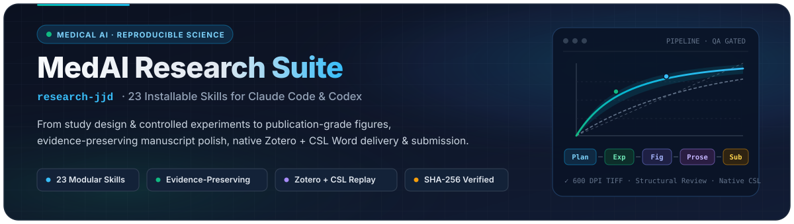
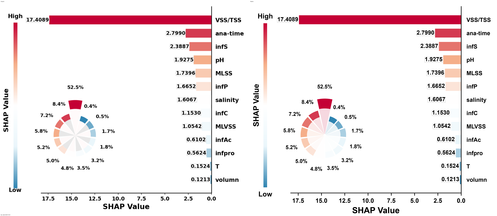
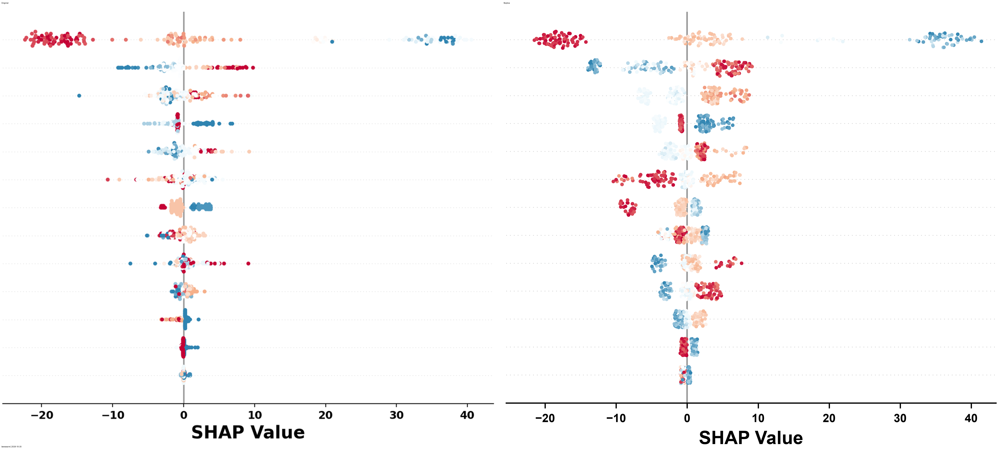
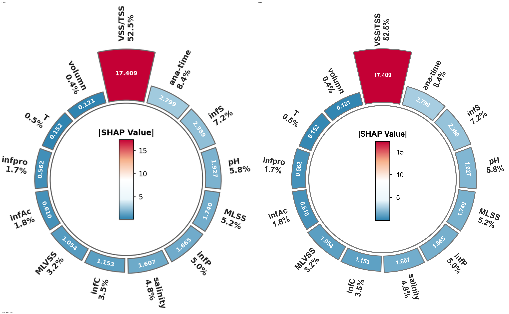

<div align="center">

<picture>
  <source media="(prefers-color-scheme: dark)" srcset="assets/hero-dark.svg">
  <source media="(prefers-color-scheme: light)" srcset="assets/hero-light.svg">
  
</picture>

<br/>

[](https://github.com/yubinfengjjd/research-jjd/releases/tag/2026-11-18)
[](install.py)
[](install.py)
[](requirements.txt)
[](LICENSE)

<p>
  <strong>End-to-End Reproducible Medical &amp; Clinical AI Research Skills for Coding Agents</strong><br/>
  From study design &amp; controlled experiments to publication-grade figures, evidence-preserving manuscript writing,<br/>
  Word assembly, native Zotero + CSL citation replay, and journal submission readiness.
</p>

<p>
  <a href="README.md">简体中文</a> ·
  <strong>English</strong> ·
  <a href="#-end-to-end-architecture">Architecture</a> ·
  <a href="#-visual-showcase">Visual Gallery</a> ·
  <a href="#-60-second-quick-start">Quick Start</a> ·
  <a href="#-23-skill-matrix">Skill Matrix</a> ·
  <a href="#-deterministic-verification-gates">Verification Gates</a>
</p>

</div>

---

## ✨ Why This Suite?

Most failures in AI-assisted medical papers come not from surface grammar, but from **metric drift across figures and prose, defensive boilerplate, stripped statistical qualifiers, peeking at frozen test sets, and broken Word/Zotero reference placeholders**. This suite packages **23 interoperable, gate-verified skills** built directly for **Claude Code** and **Codex**:

<table>
<tr>
<td width="50%" valign="top">

### 🛡️ 1. Zero Fabrication & Evidence Binding
- **Numeric provenance**: Every reported value, figure panel, and writing outline traces back to `source.json` and frozen experiment outputs—never estimated or backfilled.
- **Locked scientific boundaries**: Experiments enforce `G1–G3` gates, cumulative budgets, multi-seed runs, contribution ablations, and strict freeze-before-test isolation.

</td>
<td width="50%" valign="top">

### ✍️ 2. Evidence-Preserving Structural Polish
- **Anti-defensive discipline**: Mandatory runtime pairing with `anti-defensive-writing` removes mechanical disclaimers while protecting negative results, CIs, and single-run caveats.
- **Structural unpacking**: `scaffold_structural_review.py` and `lint_manuscript.py` enforce subsection scope inheritance, split oversized (>35-word) sentences, and sync EN/ZH groups.

</td>
</tr>
<tr>
<td width="50%" valign="top">

### 📊 3. Publication Figures & Vector Replication
- **21 ready-to-use `figkit` recipes**: Covers ROC/PR mean±SD, Bland–Altman, calibration, DCA, risk–coverage, ordinal ablation bars, and case heatmaps with automated pre-export QA.
- **Pixel/color-audited replication**: `sci-figure-replica` audits reproductions with CIEDE2000; `medfig-illustrator` drives Adobe Illustrator to redraw editable vectors.

</td>
<td width="50%" valign="top">

### 📚 4. Native Word + Production CSL Delivery
- **Print-ready Word assembly**: Embeds 600 DPI TIFF figures, three-line journal tables, and native OMML equations into paired main & supplementary `.docx` files.
- **Verified Zotero + `citeproc-js` replay**: Injects native `ADDIN ZOTERO_ITEM` fields (`I1–I9` invariants) and replays local `.csl` styles with SHA-256 provenance so `[1]–[N]` citations and full bibliographies render immediately.

</td>
</tr>
</table>

---

## 🧭 End-to-End Architecture


> [!TIP]
> **Standalone Manuscript Mode**: Already have a finished `.docx`? Run [`medical-sci-references`](medical-sci-references/SKILL.md) standalone to collect identifiers into Zotero and render `[1]–[N]` references, or run [`medical-sci-submission`](medical-sci-submission/SKILL.md) to prepare journal-specific submission packages.

---

## 🎨 Visual Showcase

`sci-figure-replica` and `medfig-render` ship with a **21-recipe panel gallery** (see [Panel Gallery Index](medfig-render/examples/gallery/INDEX.md)) and pixel/CIEDE2000 visual QA. Below are real **Original vs. Replica** comparisons bundled in the repository (synthetic evaluation data and QA markers preserved verbatim):

<table>
  <tr>
    <th width="33.3%">Bar + Polar Inset (SHAP Attribution)</th>
    <th width="33.3%">Beeswarm (High-Density Distribution)</th>
    <th width="33.3%">Radial Bar (Polar Multi-Metric)</th>
  </tr>
  <tr>
    <td></td>
    <td></td>
    <td></td>
  </tr>
  <tr>
    <td align="center"><sub>Recipe: <code>sci-figure-replica/examples/single-panel/bar_inset</code></sub></td>
    <td align="center"><sub>Recipe: <code>sci-figure-replica/examples/single-panel/beeswarm</code></sub></td>
    <td align="center"><sub>Recipe: <code>sci-figure-replica/examples/single-panel/radial</code></sub></td>
  </tr>
</table>

---

## ⚡ 60-Second Quick Start

### 1. Clone & Install All 23 Skills

```bash
git clone https://github.com/yubinfengjjd/research-jjd.git
cd research-jjd
pip install -r requirements.txt
python install.py --dry-run   # Preview installation & backup plan
python install.py             # Installs to ~/.claude/skills & ~/.codex/skills
```

`install.py` uses Python's standard library only: any existing skills are moved to `~/skill_backups/medfig_<timestamp>/` (**never deleted**), every copied file is **SHA-256 verified**, and a `.medfig_install.json` stamp is written.

<details>
<summary><strong>📦 Advanced Installer Flags: Selective Install, Update, Verify, Custom Targets & Safe Uninstall</strong></summary>

```bash
# Update only skills whose manifest SHA-256 changed
git pull && python install.py --update

# Install specific skills (automatically resolves & installs runtime dependencies)
python install.py --update --skill medical-sci-finalize --skill medpaper-pipeline

# Install into custom agent skill roots
python install.py --target D:/workspace/.agents/skills --target ~/.codex/skills

# Verify installed files byte-for-byte against the repository
python install.py --verify

# Safely uninstall selected skills (moves them to backup; keeps shared dependencies)
python install.py --uninstall
```

</details>

### 2. Entry-Point Cheat Sheet

| Goal | Recommended Entry Skill | Primary Deliverables |
|---|---|---|
| Plan a clinical AI study & run controlled experiments | `medical-research-plan` → `medimg-experiment` | Research plan, `G1–G3` gates, multi-seed & frozen test runs |
| Design and render a complete multi-figure set | `medfig-plan` → `medfig-render` / `medfig-orchestrate` | `figure-set-design.md`, 600 DPI figures, `source.json` |
| Replicate a reference plot or redraw in Illustrator | `sci-figure-replica` / `medfig-illustrator` | Audited replica + CIEDE2000 report / editable `.ai` vectors |
| Write sections, polish prose & build publication Word | `medpaper-pipeline` → `medical-sci-finalize` | Bilingual drafts, verification logs, main & supp `.docx` |
| Inject Zotero fields & `[1]–[N]` references into DOCX | `medical-sci-references` | Native-field `.docx` + verified production CSL-rendered `.docx` |
| Prepare cover letter, declarations & submission package | `medical-sci-submission` | Clean whitelisted submission archive & journal checklists |
| Unsure which figure skill to invoke | `medfig-suite` | Automatic task routing & prerequisite checklist |

---

## 🧩 23-Skill Matrix

<details open>
<summary><strong>1. Study Design & Controlled Experiments (3 Skills)</strong></summary>

| Skill | Role & Verification Scope | Spec |
|---|---|---|
| `medical-research-plan` | Socratic study design, literature anchoring, data/ethics feasibility, hypothesis falsification | [`SKILL.md`](medical-research-plan/SKILL.md) |
| `medimg-experiment` | Lightweight plan–experiment co-evolution engine (v3): general medical imaging tasks/metrics, split-leakage audit, bounded overnight exploration with baseline reuse, single pre-test check, locked test isolation & clean final plan convergence | [`SKILL.md`](medimg-experiment/SKILL.md) |
| `socratic-project-manager` | Structured Socratic interviews turning complex ideas into crisp requirements & handoffs | [`SKILL.md`](socratic-project-manager/SKILL.md) |

</details>

<details open>
<summary><strong>2. Publication Figures & Outlines (9 Skills)</strong></summary>

| Skill | Role & Verification Scope | Spec |
|---|---|---|
| `medfig-suite` | Figure entry router & prerequisite checker (never draws figures directly) | [`SKILL.md`](medfig-suite/SKILL.md) |
| `medfig-plan` | Multi-figure & table planning, chart diversity & mainline discipline (`figure-set-design.md`) | [`SKILL.md`](medfig-plan/SKILL.md) |
| `medfig-render` | Single-figure renderer powered by `lib/figkit`, 21 gallery recipes & automated export QA | [`SKILL.md`](medfig-render/SKILL.md) |
| `medfig-orchestrate` | Parallel multi-figure orchestration across isolated worktrees with review ledgers | [`SKILL.md`](medfig-orchestrate/SKILL.md) |
| `medfig-outline` | Builds Methods/Results writing outlines (`.md` + `.docx`) verified against `source.json` | [`SKILL.md`](medfig-outline/SKILL.md) |
| `medfig-schematic` | Study design & architecture schematics: English image-model prompting, QA & iteration | [`SKILL.md`](medfig-schematic/SKILL.md) |
| `medfig-illustrator` | Native vector redraw inside open Adobe Illustrator documents with editable typography | [`SKILL.md`](medfig-illustrator/SKILL.md) |
| `scipilot-medimg-figure-skill` | Journal themes, 600 DPI TIFF export, self-checks & medical imaging panels | [`SKILL.md`](scipilot-medimg-figure-skill/SKILL.md) |
| `sci-figure-replica` | Single-panel plot style analysis, Python/R replication, CIEDE2000 audit & gallery maintenance | [`README.md`](sci-figure-replica/README.md) |

</details>

<details open>
<summary><strong>3. Scientific Writing & Evidence-Preserving Polish (8 Skills)</strong></summary>

| Skill | Role & Verification Scope | Spec |
|---|---|---|
| `medpaper-pipeline` | End-to-end writing orchestrator tracking `PROJECT.md`, citation quotas & consistency checks | [`SKILL.md`](medpaper-pipeline/SKILL.md) |
| `medical-sci-methods` | Methods drafting (English + Chinese comparison + verification table) | [`SKILL.md`](medical-sci-methods/SKILL.md) |
| `medical-sci-legends` | Main/supplementary figure legends, table titles & notes synchronized to prose | [`SKILL.md`](medical-sci-legends/SKILL.md) |
| `medical-sci-results` | Results drafting grounded strictly in verified tables, figures & `source.json` | [`SKILL.md`](medical-sci-results/SKILL.md) |
| `medical-sci-introduction` | Introduction drafting with online PMID verification & gap framing | [`SKILL.md`](medical-sci-introduction/SKILL.md) |
| `medical-sci-discussion` | Discussion drafting (gated on Methods, Results, Legends & Introduction) | [`SKILL.md`](medical-sci-discussion/SKILL.md) |
| `medical-sci-abstract` | Structured 4-part Abstract (≤250 words), Keywords & Highlights | [`SKILL.md`](medical-sci-abstract/SKILL.md) |
| `anti-defensive-writing` | Required runtime dependency enforcing concise prose without stripping medical qualifiers | [`SKILL.md`](anti-defensive-writing/SKILL.md) |

</details>

<details open>
<summary><strong>4. Word Assembly, Zotero Citations & Submission (3 Skills)</strong></summary>

| Skill | Role & Verification Scope | Spec |
|---|---|---|
| `medical-sci-finalize` | Structural whole-manuscript polish, EN/ZH sync & dual Word assembly (Main + Supplementary) | [`SKILL.md`](medical-sci-finalize/SKILL.md) |
| `medical-sci-references` | Extracts PMID/DOI/arXiv/URL, updates Zotero, injects native fields & replays local CSL | [`SKILL.md`](medical-sci-references/SKILL.md) |
| `medical-sci-submission` | Target journal formatting checklists, author declarations, cover letter & clean bundle | [`SKILL.md`](medical-sci-submission/SKILL.md) |

</details>

---

## 🔒 Deterministic Verification Gates

Every critical workflow boundary is backed by deterministic Python/Node validation tools:

```bash
# 1. Read-only cross-version prose & scope density diagnostics
python -X utf8 medpaper-pipeline/scripts/lint_manuscript.py candidate/04_manuscript \
  --previous before/04_manuscript --report process/prose-comparison.json

# 2. Structural polish & Word assembly gate (verifies SHA-256, claim mappings & bilingual sync)
python -X utf8 medical-sci-finalize/scripts/check_finalize.py --edit-mode structural \
  --before PROJECT/04_manuscript --after STAGE --review-json REVIEW --changes CHANGES --report REPORT

# 3. Production CSL replay check (binds input, citeproc-js, style & locale SHA-256)
python -X utf8 medical-sci-references/scripts/render_zotero_fields.py check \
  NATIVE.docx CACHED.docx --plan PLAN.json --report final-check.json

# 4. Structural review scaffolding unit suite
python -X utf8 -m unittest medical-sci-finalize/scripts/test_scaffold_structural_review.py
```

---

## 💻 Portability & Runtime Setup

<details>
<summary><strong>Machine Portability Matrix & Codex <code>FIGKIT_LIB</code> Configuration</strong></summary>

| Workflow Scope | Local Prerequisites |
|---|---|
| Figures, prose lint & Word build | Python ≥ 3.11 (avoid Windows Store app stub) + `pip install -r requirements.txt` |
| Spreadsheets, XML fields & vector geometry | Pinned in `requirements.txt`: `openpyxl`, `lxml`, `fonttools` |
| Figure replication (`sci-figure-replica`) | Set `python_exe`, `rscript_exe`, `gallery_root` in `sci-figure-replica/config.json` or `config.local.json`; R plots require `ggplot2`, `patchwork`, `scales` |
| Visible Zotero citations (`medical-sci-references`) | Running Zotero 10 (≥ 10.0.5 recommended, local API enabled), Word Zotero plugin & Node.js |
| Illustrator vector redraw (`medfig-illustrator`) | Windows + Adobe Illustrator CC 2019 (23.x)+ with an open document (`CELL_LCT_PYTHON` if PATH lacks real Python) |
| Co-evolving experiments (`medimg-experiment`) | Real Python interpreter (avoid WindowsApps stub) + project PyTorch/timm/MONAI/nnU-Net stack (inherits local pretrained caches by default) |

For **Codex-only** installations, point `FIGKIT_LIB` and `figkit.toml` to `~/.codex/skills`:

```bash
export FIGKIT_LIB=~/.codex/skills/medfig-render/lib
```

```toml
# figkit.toml
scipilot_scripts = "~/.codex/skills/scipilot-medimg-figure-skill/scripts"
```

</details>

---

## 📄 Versioning, Attribution & License

- **Latest Release**: [2026-11-18](https://github.com/yubinfengjjd/research-jjd/releases/tag/2026-11-18) · See [`CHANGELOG.md`](CHANGELOG.md) for full release history and [`docs/evidence-aware-writing.md`](docs/evidence-aware-writing.md) for structural editing migration notes.
- **Third-Party Attribution**: `scipilot-medimg-figure-skill` is derived from [Haojae/scipilot-figure-skill](https://github.com/Haojae/scipilot-figure-skill) (MIT); full third-party notices are documented in [`NOTICE.md`](NOTICE.md).
- **License**: Released under the [MIT License](LICENSE) (public source images under `sci-figure-replica/samples/post01/source/` remain under their original authors' rights).
